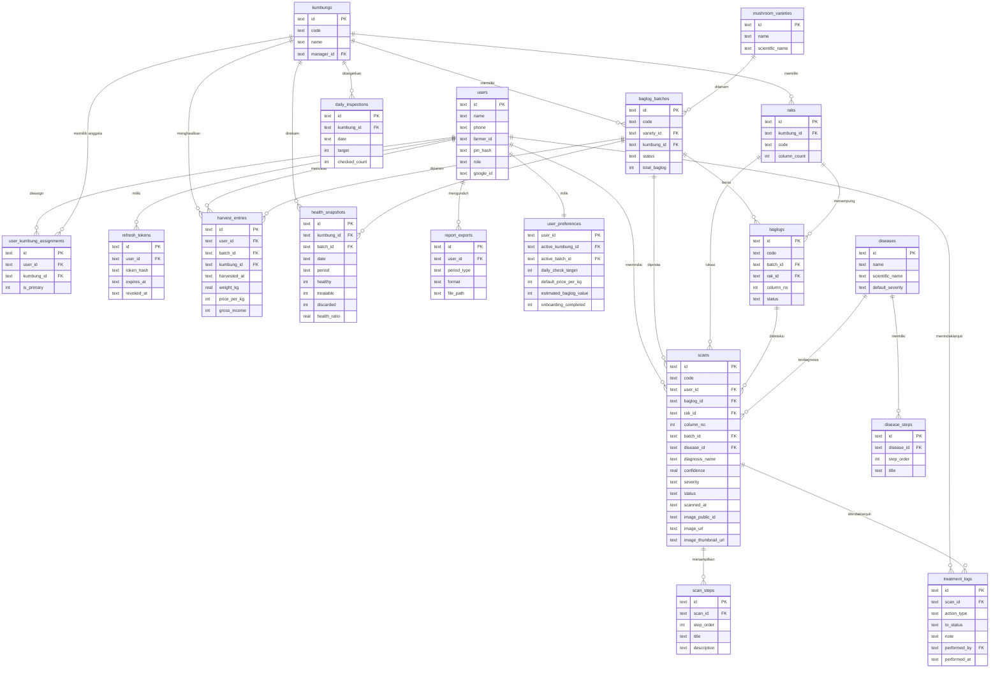

# Rancangan ERD & Skema Basis Data — TiramSehat

> Aplikasi manajemen kesehatan baglog & panen jamur tiram untuk petani BUMDes Margomulyo.

Dokumen ini berisi rancangan Entity Relationship Diagram (ERD) dan daftar tabel yang diperlukan untuk menjadikan aplikasi **TiramSehat** dinamis, menggantikan data statis pada `lib/mock/mock_data.dart`.

---

## 1. Gambaran Umum & Prinsip Desain

Saat ini semua data masih berupa _mock_ di memori. Agar aplikasi dinamis, seluruh data operasional disimpan secara persisten. Prinsip desain yang dipakai:

| Prinsip | Penjelasan |
|---|---|
| **Relasional (SQLite lokal)** | Offline-first sesuai README ("tersimpan di basis data lokal HP, aman tanpa sinyal internet"). |
| **ID `TEXT` UUID** | `id` berupa UUID v4 sehingga data siap disinkronkan antar-perangkat/server tanpa bentrok. |
| **Timestamp ISO-8601** | Semua kolom waktu memakai `TEXT` format ISO-8601 (mudah dipetakan ke `DateTime` Dart). |
| **Uang `INTEGER`** | Rupiah disimpan sebagai bilangan bulat, menghindari kesalahan pembulatan `REAL`. |
| **Berat `REAL`** | Berat panen (Kg) memakai `REAL` (mis. `18.5`). |
| **Snapshot historis** | Hasil scan menyimpan `diagnosis_name`, `scientific_name`, dan langkah penanganan sebagai _snapshot_, sehingga perubahan data master penyakite tidak mengubah riwayat lama. |
| **Normalisasi + junction table** | Relasi many-to-many (petani ↔ kumbung) menggunakan tabel penghubung. |
| **Agregat_cache** | `health_snapshots` menyimpan agregat harian/mingguan untuk grafik tren agar query laporan cepat. |

---

## 2. Diagram ERD

---

## 3. Daftar Tabel

### A. Master & Referensi (7 tabel)

| No | Tabel | Deskripsi |
|---|---|---|
| 1 | `users` | Akun petani / pengurus BUMDes. Login memakai nomor WhatsApp/ID Petani + PIN, atau Google. |
| 2 | `refresh_tokens` | Token sesi jangka panjang (rotasi, revoke, kedaluwarsa) untuk auth. |
| 3 | `kumbungs` | Blok kumbung (Blok A/B/C) tempat baglog dibudidayakan. |
| 4 | `raks` | Rak di dalam kumbung; lokasi baglog = rak + kolom. |
| 5 | `mushroom_varieties` | Referensi varietas jamur (mis. Florida Putih). |
| 6 | `diseases` | Referensi penyakit (Green Mold, Trichoderma sp., dst.) + tingkat keparahan bawaan. |
| 7 | `disease_steps` | Langkah penanganan standar per penyakit (urutan). |

### B. Operasional (6 tabel)

| No | Tabel | Deskripsi |
|---|---|---|
| 7 | `baglog_batches` | Batch/angkatan tanam (kode batch, varietas, grade, status). |
| 8 | `baglogs` | Satuan baglog beserta lokasi (rak + kolom) dan status kesehatan saat ini. |
| 9 | `scans` | Hasil diagnosa visual (kamera/manual) beserta diagnosis, keyakinan, lokasi, dan status tindak lanjut. |
| 10 | `scan_steps` | Snapshot langkah penanganan yang ditampilkan pada hasil scan. |
| 11 | `treatment_logs` | Riwayat tindak lanjut: catatan, perubahan status, pemusnahan, konfirmasi sembuh. |
| 12 | `harvest_entries` | Buku pencatatan panen harian (berat, harga, pendapatan kotor, catatan). |

### C. Pendukung (5 tabel)

| No | Tabel | Deskripsi |
|---|---|---|
| 13 | `user_kumbung_assignments` | Penghubung many-to-many petani ↔ kumbung (bisa lebih dari satu blok). |
| 14 | `daily_inspections` | Target & progres pengecekan mandiri harian per kumbung. |
| 15 | `health_snapshots` | Agregat kesehatan baglog per hari/pekan (untuk grafik tren & ringkasan siklus). |
| 16 | `report_exports` | Jejak laporan yang diunduh (CSV/PDF) beserta periode dan berkas. |
| 17 | `user_preferences` | Preferensi per pengguna: kumbung/batch aktif, target cek harian, harga default, nilai estimasi baglog. |

---

## 4. Detail Kolom per Tabel

### 4.1 `users`

| Kolom | Tipe | Null | Default | Keterangan |
|---|---|---|---|---|
| `id` | TEXT | PK | — | UUID v4. |
| `name` | TEXT | NOT NULL | — | Nama petani/pengurus. |
| `phone` | TEXT | UNIQUE | NULL | Nomor WhatsApp (identitas login alternatif). |
| `farmer_id` | TEXT | UNIQUE | NULL | ID Petani (mis. `P-01`). |
| `pin_hash` | TEXT | NOT NULL | — | Hash PIN (jangan simpan plaintext). |
| `role` | TEXT | NOT NULL | `'farmer'` | `farmer` / `officer` / `admin`. |
| `email` | TEXT | | NULL | Email (untuk Google Sign-In). |
| `google_id` | TEXT | UNIQUE | NULL | Sub Google. |
| `avatar_url` | TEXT | | NULL | URL foto. |
| `is_active` | INTEGER | NOT NULL | `1` | 0/1. |
| `created_at` | TEXT | NOT NULL | — | ISO-8601. |
| `updated_at` | TEXT | NOT NULL | — | ISO-8601. |

### 4.2 `kumbungs`

| Kolom | Tipe | Null | Default | Keterangan |
|---|---|---|---|---|
| `id` | TEXT | PK | — | UUID. |
| `code` | TEXT | UNIQUE | — | Kode blok (A/B/C). |
| `name` | TEXT | NOT NULL | — | Nama kumbung. |
| `address` | TEXT | | NULL | Alamat. |
| `manager_id` | TEXT | FK → `users(id)` | NULL | Penanggung jawab. |
| `is_active` | INTEGER | NOT NULL | `1` | 0/1. |
| `created_at` / `updated_at` | TEXT | NOT NULL | — | ISO-8601. |

### 4.3 `user_kumbung_assignments`

| Kolom | Tipe | Null | Default | Keterangan |
|---|---|---|---|---|
| `id` | TEXT | PK | — | UUID. |
| `user_id` | TEXT | FK → `users(id)` | NOT NULL | CASCADE. |
| `kumbung_id` | TEXT | FK → `kumbungs(id)` | NOT NULL | CASCADE. |
| `is_primary` | INTEGER | NOT NULL | `0` | Kumbung utama yang dipantau. |
| `assigned_at` | TEXT | NOT NULL | — | ISO-8601. |

Unique: (`user_id`, `kumbung_id`).

### 4.4 `raks`

| Kolom | Tipe | Null | Default | Keterangan |
|---|---|---|---|---|
| `id` | TEXT | PK | — | UUID. |
| `kumbung_id` | TEXT | FK → `kumbungs(id)` | NOT NULL | CASCADE. |
| `code` | TEXT | NOT NULL | — | Mis. `B-04`. |
| `block` | TEXT | | NULL | A/B/C/D. |
| `column_count` | INTEGER | NOT NULL | `8` | Jumlah kolom per rak. |
| `capacity` | INTEGER | | NULL | Kapasitas baglog. |
| `is_active` | INTEGER | NOT NULL | `1` | 0/1. |
| `created_at` / `updated_at` | TEXT | NOT NULL | — | ISO-8601. |

Unique: (`kumbung_id`, `code`).

### 4.5 `mushroom_varieties`

| Kolom | Tipe | Null | Default | Keterangan |
|---|---|---|---|---|
| `id` | TEXT | PK | — | UUID. |
| `name` | TEXT | UNIQUE | — | Mis. `Florida Putih`. |
| `scientific_name` | TEXT | | NULL | Nama ilmiah. |
| `description` | TEXT | | NULL | Deskripsi. |
| `is_active` | INTEGER | NOT NULL | `1` | 0/1. |
| `created_at` / `updated_at` | TEXT | NOT NULL | — | ISO-8601. |

### 4.6 `baglog_batches`

| Kolom | Tipe | Null | Default | Keterangan |
|---|---|---|---|---|
| `id` | TEXT | PK | — | UUID. |
| `code` | TEXT | UNIQUE | — | Mis. `Batch Panen K-04 Margomulyo`. |
| `variety_id` | TEXT | FK → `mushroom_varieties(id)` | NULL | SET NULL. |
| `kumbung_id` | TEXT | FK → `kumbungs(id)` | NULL | SET NULL. |
| `planted_at` | TEXT | | NULL | Tanggal tanam. |
| `harvested_at` | TEXT | | NULL | Tanggal panen selesai. |
| `status` | TEXT | NOT NULL | `'active'` | `planned` / `active` / `harvesting` / `completed` / `archived`. |
| `grade` | TEXT | | NULL | Mis. `98% Grade A`. |
| `total_baglog` | INTEGER | NOT NULL | `0` | Jumlah baglog dalam batch. |
| `note` | TEXT | | NULL | Catatan. |
| `created_at` / `updated_at` | TEXT | NOT NULL | — | ISO-8601. |

### 4.7 `baglogs`

| Kolom | Tipe | Null | Default | Keterangan |
|---|---|---|---|---|
| `id` | TEXT | PK | — | UUID. |
| `code` | TEXT | UNIQUE | NULL | Nomor baglog (mis. `B-04-03`). |
| `batch_id` | TEXT | FK → `baglog_batches(id)` | NULL | SET NULL. |
| `rak_id` | TEXT | FK → `raks(id)` | NOT NULL | CASCADE. |
| `column_no` | INTEGER | NOT NULL | — | Nomor kolom pada rak. |
| `status` | TEXT | NOT NULL | `'sehat'` | `sehat` / `bisa_diobati` / `sedang_diobati` / `afkir` / `dibuang` / `panen`. |
| `planted_at` | TEXT | | NULL | Tanggal tanam. |
| `harvested_at` | TEXT | | NULL | Tanggal panen. |
| `created_at` / `updated_at` | TEXT | NOT NULL | — | ISO-8601. |

Unique: (`rak_id`, `column_no`, `batch_id`) — satu slot rak hanya satu baglog aktif per batch.

### 4.8 `diseases`

| Kolom | Tipe | Null | Default | Keterangan |
|---|---|---|---|---|
| `id` | TEXT | PK | — | UUID. |
| `name` | TEXT | NOT NULL | — | Mis. `Green Mold`. |
| `scientific_name` | TEXT | | NULL | Mis. `Trichoderma sp.`. |
| `category` | TEXT | | NULL | `jamur` / `bakteri` / `virus` / `nutrisi` / `hama` / `lainnya`. |
| `default_severity` | TEXT | NOT NULL | `'treatable'` | `treatable` / `must_discard`. |
| `location_hint` | TEXT | | NULL | Petunjuk lokasi infeksi. |
| `description` | TEXT | | NULL | Deskripsi. |
| `is_active` | INTEGER | NOT NULL | `1` | 0/1. |
| `created_at` / `updated_at` | TEXT | NOT NULL | — | ISO-8601. |

### 4.9 `disease_steps`

| Kolom | Tipe | Null | Default | Keterangan |
|---|---|---|---|---|
| `id` | TEXT | PK | — | UUID. |
| `disease_id` | TEXT | FK → `diseases(id)` | NOT NULL | CASCADE. |
| `step_order` | INTEGER | NOT NULL | — | Urutan langkah (1, 2, 3…). |
| `title` | TEXT | NOT NULL | — | Judul langkah. |
| `description` | TEXT | NOT NULL | — | Penjelasan langkah. |

Unique: (`disease_id`, `step_order`).

### 4.10 `harvest_entries`

| Kolom | Tipe | Null | Default | Keterangan |
|---|---|---|---|---|
| `id` | TEXT | PK | — | UUID. |
| `user_id` | TEXT | FK → `users(id)` | NOT NULL | CASCADE. |
| `batch_id` | TEXT | FK → `baglog_batches(id)` | NULL | SET NULL. |
| `kumbung_id` | TEXT | FK → `kumbungs(id)` | NULL | SET NULL. |
| `harvested_at` | TEXT | NOT NULL | — | Tanggal & waktu panen (ISO-8601). |
| `weight_kg` | REAL | NOT NULL | — | Berat bersih (Kg), `> 0`. |
| `price_per_kg` | INTEGER | NOT NULL | — | Harga jual per Kg (Rp). |
| `gross_income` | INTEGER | NOT NULL | — | `weight_kg × price_per_kg` (disimpan sebagai snapshot). |
| `note` | TEXT | | NULL | Catatan kumbung/kondisi petik. |
| `created_at` / `updated_at` | TEXT | NOT NULL | — | ISO-8601. |

### 4.11 `scans`

| Kolom | Tipe | Null | Default | Keterangan |
|---|---|---|---|---|
| `id` | TEXT | PK | — | UUID. |
| `code` | TEXT | UNIQUE | NULL | Mis. `SCAN-0001`. |
| `user_id` | TEXT | FK → `users(id)` | NOT NULL | CASCADE. |
| `baglog_id` | TEXT | FK → `baglogs(id)` | NULL | SET NULL (jika baglog terdaftar). |
| `rak_id` | TEXT | FK → `raks(id)` | NOT NULL | CASCADE. |
| `column_no` | INTEGER | NOT NULL | — | Kolom lokasi scan. |
| `batch_id` | TEXT | FK → `baglog_batches(id)` | NULL | SET NULL. |
| `disease_id` | TEXT | FK → `diseases(id)` | NULL | SET NULL (NULL = sehat/tidak terdeteksi). |
| `diagnosis_name` | TEXT | | NULL | Snapshot nama diagnosis. |
| `scientific_name` | TEXT | | NULL | Snapshot nama ilmiah. |
| `confidence` | REAL | | NULL | Keyakinan model 0–1. |
| `infection_location` | TEXT | | NULL | Lokasi infeksi. |
| `severity` | TEXT | NOT NULL | `'treatable'` | `healthy` / `treatable` / `must_discard`. |
| `scan_method` | TEXT | NOT NULL | `'camera'` | `camera` / `manual`. |
| `image_local_path` | TEXT | | NULL | Path gambar di perangkat (offline-first). |
| `image_public_id` | TEXT | | NULL | `public_id` Cloudinary setelah upload. |
| `image_url` | TEXT | | NULL | `secure_url` Cloudinary. |
| `image_version` | INTEGER | | NULL | Version Cloudinary. |
| `image_thumbnail_url` | TEXT | | NULL | URL thumbnail (transformasi `w_400,q_auto`). |
| `status` | TEXT | NOT NULL | `'action_required'` | `action_required` / `in_treatment` / `recovered` / `discarded` / `archived`. |
| `status_note` | TEXT | | NULL | Catatan penanganan saat ini. |
| `status_tag` | TEXT | | NULL | Mis. `Urgen`, `Perawatan Ringan`, `Karantina Tuntas`, `Stabil`. |
| `scanned_at` | TEXT | NOT NULL | — | Waktu scan. |
| `created_at` / `updated_at` | TEXT | NOT NULL | — | ISO-8601. |

### 4.12 `scan_steps`

| Kolom | Tipe | Null | Default | Keterangan |
|---|---|---|---|---|
| `id` | TEXT | PK | — | UUID. |
| `scan_id` | TEXT | FK → `scans(id)` | NOT NULL | CASCADE. |
| `step_order` | INTEGER | NOT NULL | — | Urutan. |
| `title` | TEXT | NOT NULL | — | Judul langkah. |
| `description` | TEXT | NOT NULL | — | Penjelasan. |

Unique: (`scan_id`, `step_order`).

### 4.13 `treatment_logs`

| Kolom | Tipe | Null | Default | Keterangan |
|---|---|---|---|---|
| `id` | TEXT | PK | — | UUID. |
| `scan_id` | TEXT | FK → `scans(id)` | NOT NULL | CASCADE. |
| `action_type` | TEXT | NOT NULL | — | `note` / `status_change` / `treatment` / `discard` / `recover` / `archive`. |
| `from_status` | TEXT | | NULL | Status sebelum (jika perubahan). |
| `to_status` | TEXT | | NULL | Status setelah. |
| `note` | TEXT | | NULL | Catatan penanganan. |
| `tag` | TEXT | | NULL | Label tag. |
| `performed_by` | TEXT | FK → `users(id)` | NULL | SET NULL. |
| `performed_at` | TEXT | NOT NULL | — | Waktu tindakan. |
| `created_at` | TEXT | NOT NULL | — | ISO-8601. |

### 4.14 `daily_inspections`

| Kolom | Tipe | Null | Default | Keterangan |
|---|---|---|---|---|
| `id` | TEXT | PK | — | UUID. |
| `kumbung_id` | TEXT | FK → `kumbungs(id)` | NOT NULL | CASCADE. |
| `date` | TEXT | NOT NULL | — | `YYYY-MM-DD`. |
| `target` | INTEGER | NOT NULL | `0` | Target baglog yang harus dicek. |
| `checked_count` | INTEGER | NOT NULL | `0` | Jumlah yang sudah dicek. |
| `created_at` / `updated_at` | TEXT | NOT NULL | — | ISO-8601. |

Unique: (`kumbung_id`, `date`).

### 4.15 `health_snapshots`

| Kolom | Tipe | Null | Default | Keterangan |
|---|---|---|---|---|
| `id` | TEXT | PK | — | UUID. |
| `kumbung_id` | TEXT | FK → `kumbungs(id)` | NOT NULL | CASCADE. |
| `batch_id` | TEXT | FK → `baglog_batches(id)` | NULL | SET NULL. |
| `date` | TEXT | NOT NULL | — | Tanggal/awal periode. |
| `period` | TEXT | NOT NULL | `'daily'` | `daily` / `weekly` / `monthly`. |
| `total_baglog` | INTEGER | NOT NULL | `0` | Total baglog aktif. |
| `healthy` | INTEGER | NOT NULL | `0` | Jumlah sehat. |
| `treatable` | INTEGER | NOT NULL | `0` | Jumlah bisa diobati. |
| `discarded` | INTEGER | NOT NULL | `0` | Jumlah afkir/dibuang. |
| `health_ratio` | REAL | | NULL | Rasio kesehatan (0–1). |
| `created_at` | TEXT | NOT NULL | — | ISO-8601. |

Unique: (`kumbung_id`, `batch_id`, `period`, `date`).

### 4.16 `report_exports`

| Kolom | Tipe | Null | Default | Keterangan |
|---|---|---|---|---|
| `id` | TEXT | PK | — | UUID. |
| `user_id` | TEXT | FK → `users(id)` | NULL | SET NULL. |
| `period_type` | TEXT | NOT NULL | — | `week` / `month` / `year`. |
| `period_start` | TEXT | NOT NULL | — | Tanggal awal periode. |
| `period_end` | TEXT | NOT NULL | — | Tanggal akhir periode. |
| `format` | TEXT | NOT NULL | — | `csv` / `pdf`. |
| `file_path` | TEXT | NOT NULL | — | Path berkas hasil unduhan. |
| `created_at` | TEXT | NOT NULL | — | ISO-8601. |

### 4.17 `user_preferences`

| Kolom | Tipe | Null | Default | Keterangan |
|---|---|---|---|---|
| `user_id` | TEXT | PK, FK → `users(id)` | NOT NULL | CASCADE (1:1). |
| `active_kumbung_id` | TEXT | FK → `kumbungs(id)` | NULL | Kumbung yang sedang dipantau. |
| `active_batch_id` | TEXT | FK → `baglog_batches(id)` | NULL | Batch aktif. |
| `daily_check_target` | INTEGER | NOT NULL | `100` | Target cek harian bawaan. |
| `default_price_per_kg` | INTEGER | NOT NULL | `15000` | Harga default pada form panen. |
| `estimated_baglog_value` | INTEGER | NOT NULL | `3000` | Nilai ekonomi per baglog (untuk estimasi kerugian). |
| `onboarding_completed` | INTEGER | NOT NULL | `0` | 0/1. |
| `updated_at` | TEXT | NOT NULL | — | ISO-8601. |

### 4.18 `refresh_tokens`

| Kolom | Tipe | Null | Default | Keterangan |
|---|---|---|---|---|
| `id` | TEXT | PK | — | UUID. |
| `user_id` | TEXT | FK → `users(id)` | NOT NULL | CASCADE. |
| `token_hash` | TEXT | UNIQUE | NOT NULL | Hash token (jangan simpan plaintext). |
| `expires_at` | TEXT | NOT NULL | — | Kedaluwarsa token. |
| `revoked_at` | TEXT | | NULL | Waktu pencabutan (rotasi/logout). |
| `replaced_by` | TEXT | | NULL | Token pengganti saat rotasi. |
| `ip` | TEXT | | NULL | IP saat diterbitkan. |
| `user_agent` | TEXT | | NULL | User agent. |
| `created_at` | TEXT | NOT NULL | — | ISO-8601. |

---

## 5. Relasi Antar Tabel (Ringkas)

| Relasi | Jenis | Keterangan |
|---|---|---|
| `users` ↔ `kumbungs` | many-to-many | Melalui `user_kumbung_assignments`. |
| `kumbungs` → `raks` | one-to-many | Satu kumbung punya banyak rak. |
| `raks` → `baglogs` | one-to-many | Satu rak menampung banyak baglog per kolom. |
| `baglog_batches` → `baglogs` | one-to-many | Satu batch berisi banyak baglog. |
| `mushroom_varieties` → `baglog_batches` | one-to-many | Satu varietas dipakai di banyak batch. |
| `diseases` → `scans` | one-to-many | Satu penyakit bisa muncul di banyak scan. |
| `diseases` → `disease_steps` | one-to-many | Langkah penanganan per penyakit. |
| `scans` → `scan_steps` | one-to-many | Snapshot langkah per hasil scan. |
| `scans` → `treatment_logs` | one-to-many | Riwayat tindak lanjut per scan. |
| `users` → `scans` / `harvest_entries` / `treatment_logs` | one-to-many | Pelaku pencatatan/tindakan. |
| `baglog_batches` → `harvest_entries` | one-to-many | Panen per batch. |
| `kumbungs` → `daily_inspections` / `health_snapshots` | one-to-many | Target & agregat per kumbung. |
| `users` → `user_preferences` | one-to-one | Preferensi pengguna. |
| `users` → `refresh_tokens` | one-to-many | Sesi login & rotasi token. |

---

## 6. DDL / Skema SQL

| Target | Berkas | Keterangan |
|---|---|---|
| **PostgreSQL / Neon (cloud)** | [`schema.postgres.sql`](./schema.postgres.sql) | `UUID`, `TIMESTAMPTZ`, `BOOLEAN`, `BIGINT`; `gen_random_uuid()`. Panduan: [`NEON.md`](./NEON.md) |
| **SQLite (offline/lokal)** | [`schema.sql`](./schema.sql) | `TEXT` id, timestamp ISO-8601; untuk offline-first di perangkat. |

Kedua berkas berisi `CREATE TABLE`, `CHECK`, `UNIQUE`, `FOREIGN KEY`, dan indeks yang siap dijalankan (idempoten via `IF NOT EXISTS`).

---

## 7. Mapping Fitur → Tabel

| Layar / Fitur | Tabel utama | Contoh query |
|---|---|---|
| Onboarding / Login | `users`, `user_preferences` | Cari `users` by `phone`/`farmer_id`, validasi `pin_hash`. |
| Beranda — sapaan + kumbung | `user_preferences` → `kumbungs` | `active_kumbung_id` → nama kumbung. |
| Beranda — estimasi pendapatan hari ini | `harvest_entries` | `SUM(gross_income)` WHERE tanggal = hari ini. |
| Beranda — berat & harga terakhir | `harvest_entries` | `ORDER BY harvested_at DESC LIMIT 1`, `AVG(price_per_kg)`. |
| Beranda — ringkasan siklus baglog | `baglogs` JOIN `baglog_batches` | `GROUP BY status` untuk total/sehat/bisa diobati/afkir. |
| Beranda — target pengecekan | `daily_inspections` | Baris `date = hari ini`. |
| Scan — diagnosa | `diseases`, `disease_steps`, `raks` | Lookup penyakit + langkah; simpan lokasi rak/kolom. |
| Scan — simpan hasil | `scans`, `scan_steps` | Insert scan + snapshot langkah. |
| Riwayat — daftar & filter | `scans`, `treatment_logs` | Filter `status`, pencarian teks, urut `scanned_at`. |
| Riwayat — detail & konfirmasi | `scans`, `treatment_logs` | Insert log, update `scans.status`. |
| Catat Panen | `harvest_entries` | Insert panen; `gross_income` otomatis. |
| Laporan — harian | `harvest_entries` | Agregat per tanggal, selisih vs kemarin. |
| Laporan — tren kualitas | `health_snapshots` | Ambil 4 titik mingguan. |
| Laporan — akumulasi bulanan | `harvest_entries` | `SUM(gross_income)`, `SUM(weight_kg)` per bulan. |
| Laporan — batch aktif | `baglog_batches`, `baglogs` | Batch `status='active'`, hitung usia & grade. |
| Laporan — unduh CSV/PDF | `report_exports` | Insert jejak berkas. |

---

## 8. Metrik Turunan (Dihitung, Bukan Disimpan)

Beberapa angka di UI merupakan turunan yang sebaiknya dihitung saat runtime agar selalu konsisten:

| Metrik | Cara hitung |
|---|---|
| Estimasi pendapatan hari ini | `SUM(harvest_entries.gross_income)` untuk hari berjalan. |
| Tingkat kesehatan (`health_ratio`) | `baglogs.status='sehat' / total_baglog` (per batch aktif). |
| Keberhasilan panen | `healthy / (healthy + treatable + discarded)`. |
| Estimasi kerugian yang dicegah | `(jumlah scan `status='recovered'/'in_treatment'`) × user_preferences.estimated_baglog_value`. |
| Estimasi kerugian baglog | `(jumlah baglog 'afkir'/'dibuang') × estimated_baglog_value`. |
| Selisih panen harian | `total_kg(hari ini) − total_kg(hari sebelumnya)`. |
| Progres pengecekan | `daily_inspections.checked_count / target`. |
| Tren kualitas 4 pekan | Ambil `health_snapshots` `period='weekly'` 4 data terakhir. |

---

## 9. Catatan Implementasi

1. **Aktifkan foreign key**: jalankan `PRAGMA foreign_keys = ON;` pada setiap koneksi SQLite.
2. **Indeks**: tambahkan indeks pada kolom yang sering difilter/urutan (`scans.status`, `scans.scanned_at`, `harvest_entries.harvested_at`, `baglogs.status`, `daily_inspections.date`, `health_snapshots.(period,date)`). Lihat `schema.sql`.
3. **PIN**: simpan sebagai hash (mis. `bcrypt`/`argon2`), bukan plaintext.
4. **UUID**: aplikasi meng-generate UUID v4, bukan database, agar tetap berfungsi offline.
5. **Snapshot vs referensi**: `scans.diagnosis_name` dan `scan_steps` menyimpan salinan; jangan bergantung pada `diseases` saat menampilkan riwayat.
6. **Agregat**: `health_snapshots` dan `daily_inspections.checked_count` di-update oleh lapisan repository saat scan/panen baru, atau melalui trigger, agar laporan tetap cepat.
7. **Konsistensi data mock**: saat ini mock memiliki angka berbeda (home `2450` vs laporan `2400`). Basis data dinamis menghilangkan inkonsistensi karena semua layar membaca sumber yang sama.
8. **Sinkronisasi (fase lanjut)**: karena `id` UUID dan ada `created_at`/`updated_at`, skema ini dapat dipetakan ke Supabase/Firebase atau server REST untuk mode online.

---

## 10. Prioritas Implementasi

| Fase | Tabel | Tujuan |
|---|---|---|
| **Fase 1 — Fondasi** | `users`, `user_preferences`, `kumbungs`, `user_kumbung_assignments` | Login & konteks kumbung dinamis. |
| **Fase 2 — Operasional inti** | `raks`, `baglog_batches`, `baglogs`, `harvest_entries`, `scans`, `scan_steps`, `treatment_logs` | Ganti semua data mock fitur utama. |
| **Fase 3 — Referensi & laporan** | `diseases`, `disease_steps`, `daily_inspections`, `health_snapshots`, `report_exports` | Dropdown penyakit, target harian, tren, unduhan. |
| **Fase 4 — Master pendukung** | `mushroom_varieties` | Varietas terkait batch. |

---

*Dokumen ini bersifat living document — dapat disempurnakan sesuai perkembangan fitur.*
